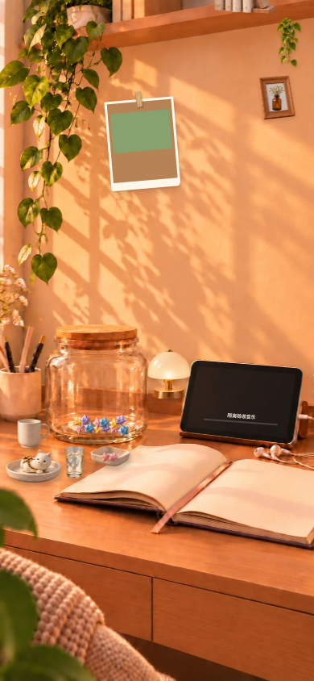
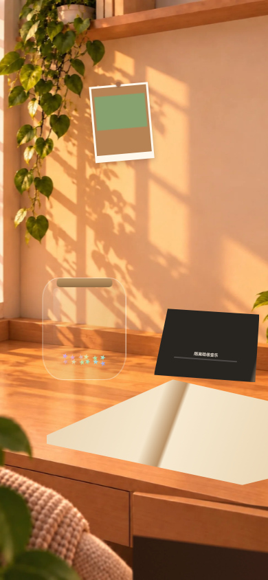

# PR #261：两套叠画与热点对齐修复

分支 `feat/space-v2-layered-rebase`；修复起点 `5ef34d206401d7755a513ffd6c0b271bedcafbf2`，sandbox 基线 `010f4710`。项目方已明确确认启用两个美术开关，开工前已登记在 PR。

## 验收来源与边界

**以下均为软件 Chromium、390×844、DPR 1、一次性隔离合成内容的真实组件验收，不是真机截图，也不是生产账号的已登录 App 验收。** 2 张真机截图（开启 / 兜底）待项目方复验；本批未合并、未部署，旧私密预览没有更新。

素材来源全部为仓库已有本地文件；素材字节、依赖、数据层与聊天模块未改。manifest 只修改已批准开关与对应说明。

## 改动清单

- `AISpace.tsx`：四个替身外壳与原内容层分开；照片热点跟随实际照片范围，原摆放坐标系、事件回调与持久化逻辑不变。
- `space.css`：校准底图中物件边界；美术开启时外壳 `display:none` 且背景透明、边框/阴影为零；兜底只画 CSS 外壳，抠图隐藏，避免第二套外形。保留透视轮廓。
- `manifest.json`：`enabled=true`、`artApproved=true`，仍须全部必需资产成功预加载才启用。
- 7 个既有测试：将历史未批准美术的输入改成显式关闭夹具，原 140 个 assert 调用逐字未变（见 assertion-contract.json）；`test_space_scene_layer` 仍先核对已启用的实际资源，再切换技术开关夹具。新增已批准 manifest 测试。
- 新增 `.mjs` 构建 + `.py` 浏览器验收脚本，不进入生产包，不新增依赖。

## 活内容与行为（单独验收）

四状态均验证：12 个真实测试记忆对应的星星仍显示且动画变换变化；玻璃光斑保留动画；系统 reduced-motion 实时变化后两者停动；真实照片显示并可拖动；歌名显示，原音频实例 seek 后进度条变换变化。内容不在隐藏外壳内，且位于相应物件边界。未新建第二个音频实例。

四状态均完成五入口并截图：照片墙对话框 / 星星罐 / 思绪书 / 一起听 / 一周情书；实际页面可返回。照片拖动超过阈值后位置改变并写回原元数据，抽屉短拉回弹、长拉打开。软件组件测试使用原回调进入原页面；不声称已验证生产登录链路。另验证 0 / 8 张照片的热点和照片墙打开。

## 数值对照

单位 CSS px，矩形格式 `(x, y, width, height)`。开启状态以不可变底图上手工标定的物件边界投影为参照，不是隐藏 img 的盒子；照片墙使用实际可见照片联合范围。兜底素材本身不显示，因此对照列标为“兜底设计槽位”，不会声称量到了不存在的图片。相机 cover 有对称裁切，表中保留完整投影边界，屏外部分不能被点击。

### enabled

| 物件 | 底图可见物件投影 / 兜底设计槽位 | 点击区 | 替身外壳 | 最大四边偏差 |
|---|---|---|---|---|
| photos | (128.97, 119.30, 95.56, 117.80) | (128.97, 119.22, 95.77, 117.95) | —（不参与布局） | 0.206px |
| jar | (61.99, 403.83, 121.15, 149.42) | (61.98, 403.81, 121.14, 149.41) | —（不参与布局） | 0.025px |
| book | (67.54, 552.23, 360.92, 153.45) | (67.53, 552.22, 360.91, 153.45) | —（不参与布局） | 0.024px |
| player | (224.02, 449.26, 153.45, 107.01) | (224.02, 449.25, 153.45, 107.00) | —（不参与布局） | 0.023px |
| weekly | (204.84, 721.84, 227.66, 85.81) | (204.83, 721.83, 227.66, 85.81) | —（不参与布局） | 0.016px |

页面错误 0；控制台错误 0；横向溢出无。详细活内容、动画及手势数据见 `report.json`。

### gate-off

| 物件 | 底图可见物件投影 / 兜底设计槽位 | 点击区 | 替身外壳 | 最大四边偏差 |
|---|---|---|---|---|
| photos | (128.97, 119.20, 95.82, 117.99) | (128.97, 119.19, 95.81, 117.98) | —（不参与布局） | 0.016px |
| jar | (61.99, 403.83, 121.15, 149.42) | (61.98, 403.81, 121.14, 149.41) | (61.98, 403.81, 121.14, 149.41) | 0.025px |
| book | (67.54, 552.23, 360.92, 153.45) | (67.53, 552.22, 360.91, 153.45) | (67.53, 552.22, 360.91, 153.45) | 0.024px |
| player | (224.02, 449.26, 153.45, 107.01) | (224.02, 449.25, 153.45, 107.00) | (224.02, 449.25, 153.45, 107.00) | 0.023px |
| weekly | (204.84, 721.84, 227.66, 85.81) | (204.83, 721.83, 227.66, 85.81) | —（不参与布局） | 0.016px |

页面错误 0；控制台错误 0；横向溢出无。详细活内容、动画及手势数据见 `report.json`。

### asset-failure

| 物件 | 底图可见物件投影 / 兜底设计槽位 | 点击区 | 替身外壳 | 最大四边偏差 |
|---|---|---|---|---|
| photos | (128.97, 119.20, 95.82, 117.99) | (128.97, 119.19, 95.81, 117.98) | —（不参与布局） | 0.016px |
| jar | (61.99, 403.83, 121.15, 149.42) | (61.98, 403.81, 121.14, 149.41) | (61.98, 403.81, 121.14, 149.41) | 0.025px |
| book | (67.54, 552.23, 360.92, 153.45) | (67.53, 552.22, 360.91, 153.45) | (67.53, 552.22, 360.91, 153.45) | 0.024px |
| player | (224.02, 449.26, 153.45, 107.01) | (224.02, 449.25, 153.45, 107.00) | (224.02, 449.25, 153.45, 107.00) | 0.023px |
| weekly | (204.84, 721.84, 227.66, 85.81) | (204.83, 721.83, 227.66, 85.81) | —（不参与布局） | 0.016px |

页面错误 0；控制台错误 0；横向溢出无。详细活内容、动画及手势数据见 `report.json`。

### cutout-failure

| 物件 | 底图可见物件投影 / 兜底设计槽位 | 点击区 | 替身外壳 | 最大四边偏差 |
|---|---|---|---|---|
| photos | (128.97, 119.20, 95.82, 117.99) | (128.97, 119.19, 95.81, 117.98) | —（不参与布局） | 0.016px |
| jar | (61.99, 403.83, 121.15, 149.42) | (61.98, 403.81, 121.14, 149.41) | (61.98, 403.81, 121.14, 149.41) | 0.025px |
| book | (67.54, 552.23, 360.92, 153.45) | (67.53, 552.22, 360.91, 153.45) | (67.53, 552.22, 360.91, 153.45) | 0.024px |
| player | (224.02, 449.26, 153.45, 107.01) | (224.02, 449.25, 153.45, 107.00) | (224.02, 449.25, 153.45, 107.00) | 0.023px |
| weekly | (204.84, 721.84, 227.66, 85.81) | (204.83, 721.83, 227.66, 85.81) | —（不参与布局） | 0.016px |

页面错误 0；控制台错误 0；横向溢出无。详细活内容、动画及手势数据见 `report.json`。

## 390×844 截图

新美术开启：



开关关闭的兜底：



另附 `asset-failure`、`cutout-failure` 总览与四状态×五入口截图，均在 evidence 目录；全部为软件浏览器截图。

## 复现与检查

```sh
node scripts/space_v2_alignment_review.mjs /tmp/space261-review
npm test
npx tsc --noEmit -p tsconfig.app.json
npm run build
npm run lint
```

截图脚本占用本地 5173；需现有 QA Python Playwright 和系统 Chromium，不向 npm 添加依赖。生成合成照片、12 条合成记忆、30 秒静音 WAV，只存在一次性浏览器上下文，不访问生产账号。

基线 npm test：278 通过 / 0 失败；修复后：279 通过 / 0 失败。tsc / build / lint 均退出 0；既有 lint warning 保留，未扩改其他模块。git diff --check 通过。

## 顺手修

无任务外顺手修。照片稀疏情况下点击框缩紧、旧候选素材与 CSS 外壳互斥，均属于本任务的对齐 / 两套叠画修复。

## 任务外发现

- 既有 `public/space/cutouts/thought-book.png` 无法由 PIL 解码；原组件有转用分层书本素材的回退。既有罐子抠图包含棋盘纹与边框。图片资产未修改，兜底统一使用对应 CSS 外壳。
- 旧 `space_v2_app_review.mjs --serve` 仅适用于开关未批准状态，启用后会按原保护规则拒绝运行；本批验证使用新增脚本，普通真实 App 仍可 `npm run build` 后 `npx vite preview --port 5173` 本地查看，未更改该旧工具或发布流程。
- 真机与真实已登录 App 复验未执行，需项目方在自己的设备与评审账号上验收；不伪造这两栏。
